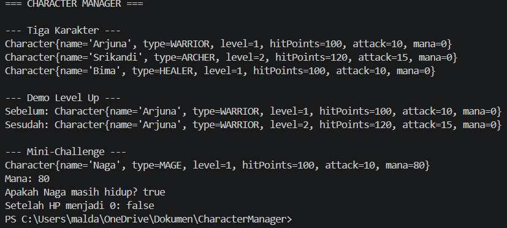
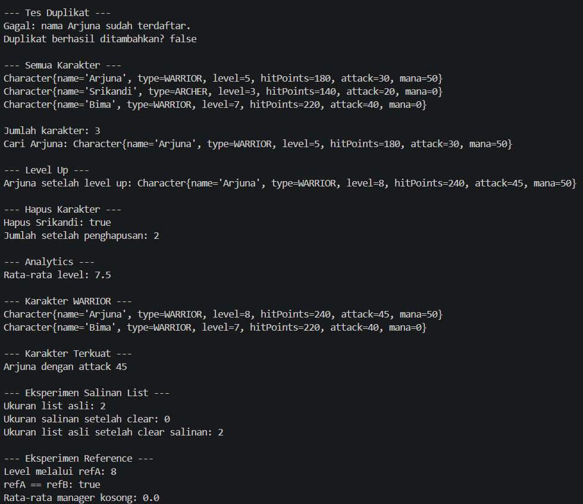
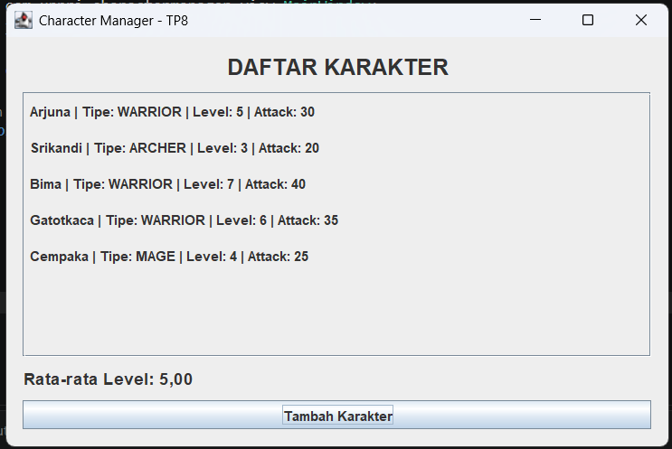
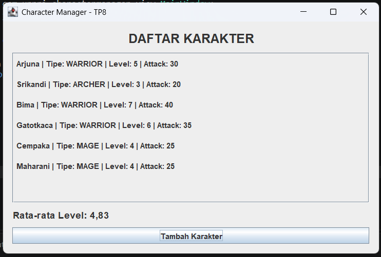

# Character Manager — TP3 (Java Visual SIH-6406)

## Deskripsi

Project ini merupakan implementasi model Character menggunakan Java.
Project mencakup enum CharacterType, dua constructor, encapsulation,
getter/setter, serta fitur level up. Fitur tambahan meliputi atribut
mana, validasi nilai mana, dan method isAlive() untuk mengecek
apakah karakter masih hidup.

## Teknologi

- Java Development Kit (JDK) 17
- Visual Studio Code
- Git dan GitHub

## Screenshot Output

Screenshot berikut menunjukkan hasil eksekusi program,
termasuk demo level up dan hasil method isAlive().



## Struktur Folder

```text
CharacterManager/
├── src/
│   └── com/
│       └── unpri/
│           └── charactermanager/
│               ├── Main.java
│               └── model/
│                   ├── Character.java
│                   └── CharacterType.java
├── screenshots/
│   └── output.png
└── README.md
```

## Identitas Mahasiswa

- Nama lengkap: M Aldafa Saf Ramadhan
- NIM: 253303621214
- Link Google Docs Bagian D:(https://1drv.ms/w/c/2131cfafda44bcb4/IQALqiI7G596R6zoCvr8Mt-1AWZWWpwnjIgt0uxH97bJ-Tg?e=Fx9RB4)
  

# TP5 — Character Manager Sprint #2

## A. Implementasi Core

Pada TP5, project Character Manager dikembangkan
dengan fitur pengelolaan data karakter (CRUD).

Fitur yang dibuat:
- equals() untuk membandingkan nama karakter.
- addCharacter() untuk menambahkan karakter.
- findByName() untuk mencari karakter.
- removeCharacter() untuk menghapus karakter.
- getTotalCharacters() untuk menghitung karakter.
- getAllCharacters() untuk mengembalikan salinan daftar.

## B. Mini-Challenge

- getAverageLevel() untuk menghitung rata-rata level.
- findByType() untuk mencari karakter berdasarkan tipe.

## C. Fitur Mandiri

Fitur tambahan: findStrongest().

Method ini mencari karakter dengan nilai attack
tertinggi dan mengembalikan null jika daftar kosong.

## D. Screenshot Output TP5



## E. Analisis Google Docs

Nama dokumen: JavaVisual_TP05_[253303621214]_[M Aldafa Saf Ramadhan]

Link Google Docs: (https://1drv.ms/w/c/2131cfafda44bcb4/IQDHBrfI-spPSY6YtXNRp8I1AaWbpzGSu2QF6nO4sIruqUA?e=ElzH4b)


# TP8 — Character Manager Sprint #3

## A. Implementasi GUI

Pada TP8, aplikasi Character Manager dikembangkan dari program berbasis console menjadi aplikasi GUI menggunakan Java Swing. Kelas `MainWindow` berada pada package `com.unpri.charactermanager.view` dan menggunakan `JFrame` sebagai jendela utama. Daftar karakter ditampilkan secara dinamis menggunakan perulangan berdasarkan data dari `CharacterManager`.

Pembuatan jendela dijalankan melalui `SwingUtilities.invokeLater()` agar GUI dibuat pada Event Dispatch Thread.

## B. Data Karakter dan Statistik

Lima karakter awal yang ditampilkan adalah:

- Arjuna — WARRIOR, level 5.
- Srikandi — ARCHER, level 3.
- Bima — WARRIOR, level 7.
- Gatotkaca — WARRIOR, level 6.
- Cempaka — MAGE, level 4.

Gatotkaca ditambahkan sebagai karakter WARRIOR untuk menambah variasi karakter petarung. Cempaka dipilih sebagai MAGE untuk menambah variasi tipe karakter.

Rata-rata level dihitung melalui method `getAverageLevel()` pada `CharacterManager`. Tombol Tambah Karakter menambahkan Maharani dengan tipe MAGE dan level 4.

## C. Screenshot

### Sebelum perubahan data



### Sesudah perubahan data



## D. Aliran Data dan MVC

Kelas `Main` membuat objek karakter dan memasukkannya ke dalam `CharacterManager`. Selanjutnya, objek `CharacterManager` diberikan kepada `MainWindow` melalui constructor. `MainWindow` mengambil daftar karakter dari manager dan menampilkannya menggunakan `JLabel` yang dibuat melalui perulangan. Statistik rata-rata level dihitung oleh `CharacterManager`, kemudian hasilnya ditampilkan pada jendela. Struktur ini menerapkan pemisahan antara pengelolaan data dan tampilan yang sejalan dengan prinsip MVC, meskipun kelas Controller terpisah belum dibuat.

## E. Analisis TP8

Dokumen analisis GUI, event-driven programming, pewarisan, dan MVC tersedia pada tautan Google Docs berikut:

**Google Docs:** (https://1drv.ms/w/c/2131cfafda44bcb4/IQBopSU3QWhFQb586hXJuF2RAW-DLU_OV9G2V8YZNdR2uCY?e=n9WX34)
